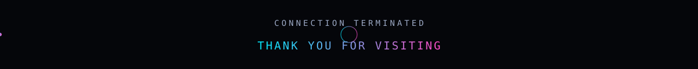

<!-- ═══════════════════════════════════════════════════════════════════════
     clvp012 // profile interface
     Replace the project placeholders when you have repositories to feature.
     ═══════════════════════════════════════════════════════════════════════ -->

<div align="center">




<br />

<a href="https://github.com/clvp012"></a>


</div>


## `01 / ABOUT`

```text
┌─ IDENTITY ──────────────────────────────────────────────┐
│  USER       clvp012                                    │
│  ROLE       Independent Developer                      │
│  STATUS     Building something new                     │
│  INTERESTS  Software · Automation · Creative coding    │
└────────────────────────────────────────────────────────┘
```

Independent developer exploring software, new technologies, automation, and creative coding. I like taking an idea, experimenting with it, and turning it into something real.


## `02 / TECH STACK`

<div align="center">

**LANGUAGES**


**TOOLS & ENVIRONMENT**


</div>


## `03 / GITHUB ANALYTICS`

<div align="center">


<br />


</div>


## `04 / CONTRIBUTION MATRIX`

<div align="center">


</div>

> **If the snake is not visible yet:** open the repository’s **Actions** tab → **Generate contribution snake** → **Run workflow**. On the first successful run, GitHub will create the `output` branch and publish the SVG. Make sure Actions are enabled and repository Actions permissions allow write access.


## `05 / PROJECTS`

<div align="center">

| PROJECT | DESCRIPTION | STATUS |
|:--|:--|:--:|
| `PROJECT_001` | A project currently taking shape. | `WIP` |
| `PROJECT_002` | Another experiment in progress. | `WIP` |
| `PROJECT_003` | More things coming. | `SOON` |

</div>

*Replace these placeholders with real projects and repository links when ready.*


<div align="center">



<sub>© clvp012 · Made with curiosity and code.</sub>

</div>
